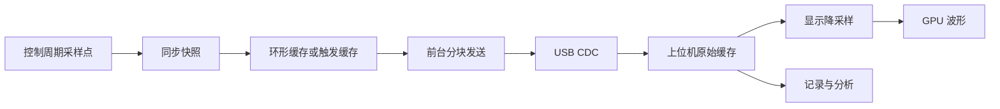

# 高性能电机调试上位机与高速示波器设计及交接

更新日期：2026-11-08（Asia/Shanghai）

## 1. 交接状态与用户需求

用户要求参照当前通讯方式，设计一个性能更好的上位机，并先输出设计思路：

- 每个需要配置的结构体有独立的配置界面。
- 提供电机使能、失能、故障复位、寻相及其他控制模式的操作界面。原始需求中的重复“使能”按“使能/失能”理解。
- 提供高性能示波器，与下位机配合实现至少 10 kHz、最高到电流环频率的变量采样。
- 考虑 USB 带宽，根据数据量自动选择连续采样或间断采样。
- 波形绘制使用 GPU，支持高数据量下流畅显示。

**当前阶段：用户已授权开始实施，并要求每完成一步都在本文记录。最新进度见第 13 节；前文保留设计背景，具体已实现范围以进度记录和源码为准。**

**2026-11-08 最新交接入口：[HANDOFF_NEXT.md](HANDOFF_NEXT.md)。步骤 22 已完成桌面部署同步；步骤 23 开始实际电机调试并修复编码器读取/恢复及保护。限压寻相和零目标 PWM 因编码器故障 51 停止，已失能，等待用户整改编码器与功率线并行的接线；真实运动尚未验收通过。**

本文中的技术栈、阈值、缓存容量和性能目标均为建议，不能视为已实现或已实测指标。后续应以用户的新指示和当前源码为准。

最初整理本文时仅新增文档；后续代码改动、验证结果和未完成项逐步记录在第 13 节。现已进行真实 USB 无电机初测与限定场景 GPU 验证；真实电机及完整负载性能仍待验收。

## 2. 已调查的工程现状

### 2.1 通讯与对象字典

- 当前通过 USB CDC 访问对象字典，不是完整 CANopen 节点，也不是 CAN 总线 SDO 通讯。
- 对象字典 CSV 是地址、类型和访问权限的唯一来源，生成文件不可手改。
- 当前说明记载：166 个配置参数、432 个只读运行变量，以及最大子索引和控制/系统条目，共 626 项。实施前重新核对当前 CSV。
- v1 为定宽十六进制 ASCII 文本协议，按行解析，以请求编号匹配响应；每次请求访问一个标量。
- 现有上位机为 Python 标准库 + Tkinter + Win32 COM，后台线程串行读写，默认一次一个未完成请求。
- 现有 CDC 接收环形队列为 512 字节；前台轮询处理请求；发送完成前保持发送缓冲区有效。
- 当前代码配置为 USB OTG FS / Full Speed / 内置 PHY，USB DMA 未启用。
- 多个变量逐项读取不属于同一控制周期快照，不能作为高频同步采样实现。

关键源码与说明：

| 路径 | 用途 |
| --- | --- |
| [canopen/README.md](../canopen/README.md) | 对象字典、命令、权限和通讯限制 |
| [canopen/object_dictionary.csv](../canopen/object_dictionary.csv) | 对象定义 |
| [tools/generate_od.py](../tools/generate_od.py) | 对象字典生成器 |
| [canopen/od.h](../canopen/od.h)、[od.c](../canopen/od.c) | 类型化对象字典访问 |
| [canopen/od_user.c](../canopen/od_user.c) | 实际变量绑定 |
| [canopen/od_protocol.c](../canopen/od_protocol.c) | v1 文本协议 |
| [canopen/od_cdc.c](../canopen/od_cdc.c) | USB 缓存、轮询、状态门控与临界区 |
| [canopen/od_commands.c](../canopen/od_commands.c) | 控制与系统命令 |
| [USB_DEVICE/Target/usbd_conf.c](../USB_DEVICE/Target/usbd_conf.c) | 当前 USB 硬件配置 |
| [USB_DEVICE/App/usbd_cdc_if.c](../USB_DEVICE/App/usbd_cdc_if.c) | CDC 收发回调 |
| [tools/od_monitor/README.md](../tools/od_monitor/README.md) | 现有上位机与协议说明 |
| [tools/od_monitor/app.py](../tools/od_monitor/app.py) | 现有 Tkinter 界面 |
| [tools/od_monitor/client.py](../tools/od_monitor/client.py) | 现有客户端通讯 |

### 2.2 配置结构体与独立页面

[motor_control/global.h](../motor_control/global.h) 中 `Global_Configs_t` 包含七组配置，当前单轴为轴 0：

| 页面 | 结构体 | OD 主索引 | 参数数量 | 建议组织 |
| --- | --- | --- | --- | --- |
| 电机参数 | `Motor_Config_t` | `0x2000` | 26 | 电气、机械、额定值、保护 |
| 编码器参数 | `Encoder_Config_t` | `0x2001` | 11 | 类型、方向、分辨率、校准 |
| 电机控制器 | `Motor_Controller_Config_t` | `0x2002` | 17 | 策略、补偿、限制 |
| 观测器 | `Motor_Observer_Config_t` | `0x2003` | 8 | 算法与观测器参数 |
| 控制环 | `Loop_Controller_Config_t` | `0x2004` | 58 | 电流、速度、位置等分组 |
| 环路滤波器 | `Loop_Filter_Config_t` | `0x2005` | 36 | 反馈、给定、输出路径 |
| HFI | `HFI_Config_t` | `0x2006` | 10 | 注入与解调 |

运行变量目前映射在 `0x2100`–`0x2109`，按内核、电源、原始采样、电机基本状态、编码器、电机状态、观测器、控制环、FOC、HFI 分组。

### 2.3 已有命令与约束

| 地址 | 当前语义 |
| --- | --- |
| `0x0000:01` | 写 1 使能、写 0 失能 |
| `0x0000:02` | 写 1 启动寻相 |
| `0x0000:03` | 辨识：1 电阻、2 电感、3 极对数、4 磁链 |
| `0x0000:04` | 只读辨识内部阶段 |
| `0x1000:01` | 故障复位，不是 MCU 重启 |
| `0x1000:02` | 保存 Flash |
| `0x1000:03` | 应用 RAM 参数 |
| `0x1000:04` | 最近 Flash 状态 |
| `0x1000:05` | 配置待应用标志 |

必须保留的现有语义：

- 参数写入只修改 RAM；普通配置只允许失能且处于 `MS_IDLE` / `MS_Err` 时写入。
- 修改后须应用成功，才能使能或保存 Flash。
- 应用会重新初始化相关模块，并清除已寻相标志；必要时等待采样校准完成。
- 使能本身不自动启动运动。
- 命令启动成功不等于算法执行完成，完成状态需结合状态机、故障和结果判断。
- 当前齿槽、惯量、摩擦、重力辨识不受支持，不应因存在枚举或函数声明就显示为可用。
- 运行变量只读，不能为新增控制界面直接放开整个状态结构体写权限。
- 现有写入和命令超时不自动重试，避免重复执行；超时后重新连接并读取确认。
- 当前断开串口不会自动失能；新的在线控制超时策略需要明确设计，不能假定现有固件已有看门狗。
- Flash 擦写要求停机；不能因自动保存而在运行中擦写。

### 2.4 实时频率与内存

调查时 [bsp/hw_vesc_6_4.h](../bsp/hw_vesc_6_4.h) 配置为：

- 单轴。
- PWM：20 kHz。
- 高频实时中断：20 kHz。
- 普通实时中断：10 kHz。

高频入口见 [motor_control/hal/realtime.c](../motor_control/hal/realtime.c) 的 `high_realtime_callback()`，其中调用编码器和电机高频更新；控制实现见 [motor_control/motor.c](../motor_control/motor.c)。中断计时可参考 [Core/Src/stm32f4xx_it.c](../Core/Src/stm32f4xx_it.c) 及 `global_status.core_status` 中的耗时字段。

第一阶段采样验证目标为 10 kHz 和当前电流环 20 kHz。实际采样钩子必须核实控制更新位置、编译选项和中断优先级后确定，不能仅凭 PWM 频率推断变量更新率。

[STM32F405XX_FLASH.ld](../STM32F405XX_FLASH.ld) 划分了 128 KiB 普通 SRAM、64 KiB CCM；Flash 中另有两个配置扇区。采样缓存大小尚未确定，须检查链接 map、栈和运行余量；不能把全部 RAM 用作采集缓存，也不能假定 CCM 对 DMA 可访问。

## 3. 总体方案

推荐：**C++ / Qt 6 / QML 上位机 + 下位机同步采样引擎 + USB 二进制流 + GPU 波形组件**。

基本原则：下位机决定采样时刻，USB 搬运数据，上位机存储、分析、显示。采样频率、传输批次和界面刷新率分别设计。



建议上位机模块：

| 模块 | 职责 |
| --- | --- |
| 设备连接层 | CDC 发现、连接、异步收发、断线 |
| 协议层 | 帧解析、请求匹配、能力协商、会话与错误 |
| 参数模型 | 对象字典、单位、枚举、校验、编辑记录 |
| 电机控制服务 | 完整目标提交、模式切换、执行状态 |
| 采集服务 | 通道、触发、模式选择、缓存、完整性检查 |
| 数据处理层 | 显示降采样、统计、FFT、文件记录与回放 |
| 界面与绘图层 | 配置页面、控制面板、自定义 GPU 示波器 |

通讯、数据处理、文件写入和界面渲染按数据块交接，使用有容量限制的队列。线程具体分工按实际负载确定；避免逐采样点发送 UI 信号。

## 4. 配置界面设计

- 七个顶层结构体分别有独立页面，嵌套结构体使用分组卡片或子页，数组保留层级。
- 继续以 CSV 定义地址、类型、权限；另加界面元数据描述中文名、单位、精度、枚举、范围、说明、结构体路径和依赖条件。
- 新增参数不应要求手写完整表单；先由元数据生成通用字段，特殊参数再定制控件。
- 本地编辑值、设备 RAM 值、配置应用状态分别表达；Flash 保存状态单独显示。
- 支持读取本组、读取全部、只写修改项、应用、回读、显式保存、导入导出和差异检查。
- 标量类型溢出、NaN/Inf 与业务范围校验分层处理；业务最终裁决仍在下位机。
- 部分写入失败必须逐项展示，不得将整组标记为成功。
- 后续可增加暂存—整体校验—提交事务，避免组合参数部分更新；现有 v1 不具备此能力。
- 增加固件版本、对象字典哈希和能力查询，避免加载错误版本 CSV 后继续配置。

配置流程：读取 → 编辑 → 写入修改项 → 应用 → 回读确认 → 按需保存 Flash。

## 5. 电机控制设计

固定显示使能、失能、故障复位、寻相、辨识入口，以及当前模式、故障、校准/寻相状态、关键反馈、目标值和限幅信息。

候选模式来源为 [motor_control/motor_api.h](../motor_control/motor_api.h) 与 [motor_control/motor_api.c](../motor_control/motor_api.c)：

- 基础闭环：电流、扭矩、速度、位置。
- 调试：VF、IF、HFI 开环。
- 扩展：力控、阻抗、导纳、示教。
- 周期同步：CST、CSV、CSP。
- 分析：电流、速度、位置扫频。

以上为候选能力，不代表均已通过通讯开放或完成运行验证。固件应发布支持列表，界面只启用已实现、已验证的模式。

模式与配套目标参数应作为一条完整命令提交，例如位置、速度、加速度、jerk 同时校验。建议通讯前台通过命令邮箱交给实时循环，在规定周期边界生效；不直接分次覆盖实时状态字段。

区分“已接收、已生效、已完成/失败”。状态检查、限幅、模式互斥与超时处理由固件保证，界面同步展示原因。

USB 与桌面系统不提供硬实时调度保证。CST/CSV/CSP 应设计为目标序列传输、下位机缓冲和插补；不能依靠桌面定时器精确驱动电流环。在线运动模式应明确通讯超时后的行为，并单独验证。

## 6. 下位机采样引擎

### 6.1 采样路径

1. 启动前以 OD 地址选择变量，校验类型、权限、可采样性、通道数和资源预算。
2. 预解析为类型化访问表；实时中断内不查字典，不处理文本。
3. 在约定控制更新位置执行固定数量的读取、触发判断和缓存写入。
4. 前台负责封包与 USB 发送，发送完成前缓冲区不可复用。

实时路径禁止 USB 等待、动态内存分配、字符串格式化及不受控循环。缓存满也不得阻塞电流环。

### 6.2 同步语义

- 明确采样点位于电流反馈更新、控制计算、PWM 提交的哪个位置。
- ADC、电流参考、控制器输出和实际 PWM 的作用时刻可能不同，应在元数据或说明中表达。
- 慢速变量在高速采样中可能重复，显示其源更新频率。
- 不同中断更新的变量需要快照/发布规则；集中读取不自动保证同周期一致性。
- 64 位值及复合数据需要处理原子性，不能任意 `memcpy` 整个运行结构体来宣称同步。
- 记录设备时间基准、样本序号、实际采样间隔，时间轴不使用主机收包时间代替。

### 6.3 缓存预算示例

假设经过内存评估后可分配 64 KiB 纯样本空间：8 通道 × 4 字节 × 20 kHz = 640,000 B/s，可保存约 102 ms 连续样本。实际容量还要扣除元数据和缓冲管理空间。

64 KiB 只是说明用的假设，不是已分配容量。是否使用普通 SRAM、CCM、分块缓冲或双缓冲，应结合 CPU 搬运、当前无 USB DMA、未来 DMA 可访问性和已有内存布局决定。

## 7. 连续与间断采样自动选择

提供“自动 / 强制连续 / 强制间断”，默认自动。

- 连续：采集与上传并行，用于长期趋势、在线调参。
- 间断：保持目标采样频率采满一段，冻结并上传，再重新布防；支持预触发、后触发、单次和重复捕获。
- 间断采样的段内采样率不降低；段与段之间有真实空隙，绘图与文件必须标记，不能拼成连续时间。

需求估算：

```text
每秒需求 = 采样率 × 单帧全部通道字节数 + 分块协议开销
```

32 位通道、不含协议开销的示例：

| 通道数 | 采样率 | 数据量（十进制） |
| --- | --- | --- |
| 4 | 10 kHz | 160 kB/s |
| 8 | 10 kHz | 320 kB/s |
| 4 | 20 kHz | 320 kB/s |
| 8 | 20 kHz | 640 kB/s |
| 16 | 20 kHz | 1,280 kB/s |

USB Full Speed Bulk 理想有效负载上限约 1.216 MB/s；实际 CDC 更低，且需留控制与协议余量。因此 16 通道 × 20 kHz × 32 位原始数据不能持续完整上传。8 通道 × 20 kHz 是否可持续必须实测。

建议自动策略：

1. 连接后短时测吞吐；运行中监测吞吐、队列水位和延迟。
2. 初始连续预算建议使用实测稳定吞吐的约 70%，具体阈值经测试调整。
3. 同时满足 USB 带宽、实时采样耗时、缓存三个预算才允许连续。
4. 超预算或持续积压时在明确的数据段边界转为间断，记录模式变化。
5. 恢复连续使用更低占用阈值和稳定等待时间，形成迟滞，避免反复切换。
6. 强制连续但预算不足时明确拒绝或提示调整，不暗中降低采样率。

间断模式解决平均传输带宽，不能解决单次采样开销过大；CPU 预算不足时仍须限制通道数。缓存满的停止/丢块策略、重布防条件、段编号和缺口报告需明确。

## 8. 二进制协议扩展

保留 v1 兼容入口。新上位机协商进入 v2 后，统一用二进制帧承载控制响应、状态与采样数据；模式切换需要明确握手、边界和回退规则，不在同一字节流中无规则混合文本和二进制。

采样帧候选字段：

```text
帧标识、协议版本、消息类型、长度、会话号
流配置号、块序号、首样本序号、样本数
设备时间基准、采样间隔、状态标志
紧凑样本负载、CRC
```

- 通道地址、类型、名称、单位在配置阶段交互；采样块不重复发送完整通道描述。
- 显式规定小端编码、字段宽度、最大帧长、对齐、CRC 算法和时间计数回绕规则。
- 解析器支持任意拆包、粘包、长度检查、校验错误和重同步。
- 会话号/流配置号防止重连或修改通道后误解旧数据。
- USB 发送优先级建议：失能及控制响应 → 状态事件 → 波形。
- 波形分块大小要平衡效率与控制延迟，不能让大块数据长期占住响应通道。
- 状态与采样流可合并传输，但不因此放宽普通参数写入的状态约束。
- 需定义请求超时与重复请求规则；继承现有非幂等命令不盲目重试的语义。

## 9. GPU 波形与数据处理

建议使用自定义 `QQuickItem + QSGGeometryNode`，按曲线生成 GPU 几何；如后续性能分析确有需要，再评估更底层的渲染接口。

- 原始数据按实际采样率接收，显示按约 60 FPS 独立刷新。
- 避免逐点创建 QML 对象、逐点属性更新或每帧完整复制所有历史数据。
- 按像素宽度生成显示层级，保留各桶最小值、最大值及时间顺序，避免漏掉尖峰。
- 放大时读取更细层级，最终展示原始点；测量以原始数据为依据。
- GPU 缓冲复用和批量更新，曲线、网格、坐标轴分开管理。
- 缺失或间断段断开曲线，不跨缺口连线。
- 原始记录使用分块二进制格式，保存通道定义、设备/固件版本、时间基准、采样率、缺口与模式切换信息；CSV 用于离线导出。
- FFT、统计、压缩和写盘在后台完成；处理慢时不阻塞 UI 或控制响应。
- 记录队列满时需明确报错或停止记录，不能静默把降采样数据当作完整原始记录。

GPU 性能目标须绑定目标电脑、分辨率、通道数和可视历史长度后验证，不能仅凭采用 Qt 就认为已达标。

## 10. 分阶段实施与验收

### 阶段一：测量与采样通讯原型

- 核实当前构建、内存 map、控制路径和 USB 实现。
- 在电机不同负载下测控制中断最坏耗时与余量。
- 测 CDC 批量发送的持续吞吐、延迟与队列积压。
- 定义能力查询、版本匹配和 v2 协议。
- 完成最小同步采样与原始数据接收，优先验证 10 kHz / 20 kHz。

### 阶段二：配置与电机控制

- 建立 Qt 工程与参数模型，完成七个结构体配置页面。
- 接入现有命令和状态显示。
- 建立完整目标提交与实时命令邮箱。
- 按能力逐项开放其他控制模式，验证互斥、限幅和失败路径。

### 阶段三：完整示波器

- 连续、间断、触发采样和自动选择。
- 序号、CRC、缺口、缓存溢出与重连处理。
- GPU 波形、缩放、拖动、游标、显示层级。
- 验证采集满载时控制命令仍及时响应。

### 阶段四：记录、分析与完善

- 长时间记录、回放、FFT、统计与 CSV 导出。
- 工作区、参数方案与通道预设保存。
- 部署打包、真实硬件压力测试和使用说明。

### 验收维度

| 维度 | 需要证明的结果 |
| --- | --- |
| 采样 | 10 kHz 与当前 20 kHz 同步采样，序号和设备时间正确 |
| 实时性 | 开启采集后最坏控制耗时仍保留足够余量 |
| 带宽 | 不足时能进入间断，段内保持目标频率，缺口可识别 |
| 完整性 | 拆包、断线、损坏、溢出和旧会话数据均正确处理 |
| 控制 | 满载采集时可及时失能，模式切换、限幅、超时行为明确 |
| 显示 | 约定硬件与负载下约 60 FPS，缩放拖动流畅 |
| 配置 | 版本匹配，部分失败可见，RAM/应用/Flash 状态正确 |
| 记录 | 原始数据、时间基准、元数据和缺口可完整回放 |

## 11. 下一位接手者的起点

1. 先读本文件、`canopen/README.md`、`tools/od_monitor/README.md`，再核对当前源码，避免把设计建议当作已有功能。
2. 查看仓库及上级目录的 `AGENTS.md`，并检查 `git status`。整理本文时仓库已有大量修改及未跟踪文件，其中包括控制命令与测试；不要重置、清理或覆盖这些工作。
3. 如用户继续要求设计，优先细化协议字段、采集状态机、通道元数据和 UI 信息结构。
4. 如用户要求实施，先做阶段一的可测原型，得到吞吐、最坏中断耗时和内存预算，再承诺连续通道数量。
5. 确认本机 Qt/C++ 工具链与构建路径；现有工程已有阶段一固件采集链路及 `tools/scope_client/` 参考工具，尚无本方案的新 Qt 上位机实现。
6. 新增协议与采集逻辑应测试解析边界、序号、状态切换、缓冲所有权和资源上限；沿用现有生成器与命令回归测试。
7. 软件测试通过与真实硬件验证分别报告。现有 README 中记载的历史测试结果不等于本轮重新验证。

尚待确定：

- 持续采样期望通道数、最大历史长度及目标电脑/GPU。
- 真实可分配 RAM、CDC 稳定吞吐及不同模式的采集耗时。
- 触发类型、缓存组织、重布防方式与溢出策略。
- v2 精确字段、协商流程、错误码与协议兼容策略。
- UI 元数据维护/生成方式及新增工程目录。
- 各控制模式实际可用性、周期目标缓冲与通讯超时策略。

这些问题可通过代码调查、原型和合理默认值继续推进；只有影响用户行为或无法由上下文推断的关键选择再向用户确认。

## 12. 外部技术依据

- [Qt Quick Scene Graph](https://doc.qt.io/qt-6/qtquick-visualcanvas-scenegraph.html)：GPU 场景图与渲染线程机制。
- [Qt 自定义几何示例](https://doc.qt.io/qt-6/qtquick-scenegraph-customgeometry-example.html)：`QQuickItem` / 场景图几何实现。
- [ST STM32F405/415 产品资料](https://www.st.com/en/microcontrollers-microprocessors/stm32f405-415.html)：芯片资源；具体可用资源仍以本工程链接结果为准。
- [Linux USB 主机接口文档](https://kernel.org/doc/html/v4.16/driver-api/usb/usb.html)：Full Speed Bulk 理想负载上限；不用于承诺当前 Windows CDC 的实测性能。

## 13. 实施记录

### 步骤 1：基线检查（2026-11-08，已完成）

- 用户已授权开始代码实施，并要求逐步更新交接文档。
- 检查工作区和上级目录，未发现适用的 `AGENTS.md`。现有未提交改动保留，不重置或覆盖。
- `cmake --build --preset Debug` 成功，基线输出为 `ninja: no work to do`。
- `python tests/canopen/test_generator.py`：8 项通过；测试内主动构造无效类型和过期生成文件的报错属于预期输出。
- `python tests/canopen/test_monitor.py`：10 项通过。
- 本机可用 Python 3.13、CMake、Ninja、GNU ARM 15.3；Qt 工具与本机 C 编译器不在 PATH，继续定位已有工具，不据此更改技术方案。
- 历史构建日志显示 RAM 19,688 B、CCM 6,940 B、Flash 208,220 B；这只是已有日志，新增代码后需重新链接核对。
- 下一步：先实现可独立测试的 v2 二进制帧和预解析采样读取，再接入 CDC 与控制周期，提供参考客户端完成软件端到端验证。

### 步骤 2：二进制帧与预解析读取（2026-11-08，已完成）

- 新增 `canopen/od_wire.h/.c`：v2 使用 COBS + 零分隔，16 字节小端头、最多 1,088 字节负载、CRC32/IEEE；带版本、类型、会话和序号，解析器固定内存，损坏/超长包在下一个分隔符后恢复。
- `od.h/.c` 新增 `OD_ReadPlan`、`od_prepare_read()`、`od_read_prepared()`；冻结字典后预解析地址，实时读取不再二分查找，仍保留真实类型、volatile 与短枚举转换。同步和 64 位原子性仍由调用者负责。
- 新增 `tests/canopen/test_wire.c` 并接入现有测试运行器：覆盖全部负载长度 0–1,088、零字节及 254 字节边界、CRC 标准向量、损坏/溢出后恢复、容量拒绝和准备读取生命周期。
- 找到本机 Clang/LLD：`E:/MATLAB/R2023b/toolbox/sldrt/clang/win64/`；未安装新工具。
- 验证：`python tests/canopen/run_tests.py --cc E:/MATLAB/R2023b/toolbox/sldrt/clang/win64/clang.exe --lld E:/MATLAB/R2023b/toolbox/sldrt/clang/win64/lld.exe` 全部通过，包括 18 项 Python、原有 C 字典/CDC/命令回归与新增 C 用例。
- `cmake --build --preset Debug` 编译链接成功；RAM 19,688 B、CCM 6,940 B、Flash 208,308 B。此时帧模块尚未接入 CDC，其未引用部分会被链接器裁剪，因此该内存结果不是采集系统最终占用。
- 下一步：固定预算的采样缓存与采集状态机，随后接入二进制会话和采样钩子。

### 步骤 3：固定内存采样引擎（2026-11-08，已完成）

- 新增 `canopen/od_scope.h/.c`：最多 16 通道、16 × 1,024 B 样本块，支持整除分频、连续采集和采满后冻结的间断采集。
- 仅允许 `0x2100`–`0x2109` 中子索引非零的只读运行标量，拒绝重复通道、错误类型、配置/命令地址及 64 位值。64 位采样待定义一致性机制后再开放。
- 块所有权使用编译期确认无锁的 C11 原子发布/获取；生产者不覆盖消费者持有的块。连续模式缓存满时停止并报告溢出，不阻塞控制循环，不静默覆盖样本。
- 记录跨采集段连续的 64 位控制 tick、配置号、段号、块号；间断模式在冻结前不向消费者暴露块。显式停止可发布最后一个不完整块。
- `tests/canopen/test_scope.c` 覆盖分频、逐点值与时间、间断冻结、未排空禁止重配/重启、连续满缓存停止、100 次环形周转和非法通道。
- 本机 C/Python 回归与 Debug 固件编译链接均通过。此时采样器仍未接入实时入口，链接占用尚不反映实际缓存。
- 下一步：CDC v1/v2 协商、二进制命令分发、采样数据发送与高频控制钩子。

### 步骤 4：固件采集链路接通（2026-11-08，已完成）

- v1 增加 `B SSSSSSSS` 协商，返回正常文本 `O SSSSSSSS 00 02`；只在 ACK 发送完成后进入 v2，原有读写仍兼容。
- `od_cdc.c` 接入能力查询、v2 标量读写、采集配置/启动/停止/状态/数据上传和退出到 v1；读写复用原有状态门控与命令分发，没有放开运行结构体写权限。
- 每次进入 v2 分配非零会话号，请求序号严格递增；重复/过期请求不执行，也不自动重试。退出和重新协商可创建新会话。
- RX 缓存扩大为 2,048 B；采样帧包含配置号、段号、块号、设备控制频率、64 位首 tick、分频、点数和步长。
- 控制响应先于待发送波形；数据复制到独立 TX 存储后释放采样块，USB BUSY 时仅重发缓冲，不重新执行命令。
- `high_realtime_callback()` 在 `motor_update_frt(0)` 后调用采样钩子。当前配置只接受产生至少 10 kHz 的整数分频，20 kHz 板级配置对应 20/10 kHz；慢环字段仍保留原有更新率，并非跨 ISR 的原子快照。
- DTR 下降恢复文本会话；物理断线和会话重置立即停止采样。DTR 不等于端点复位，因此会等待已提交 USB 缓冲发送完成再复用；物理 USB 复位才取消旧 TX 所有权。
- CDC C 测试增加协商 ACK 生命周期、会话/重复请求、USB BUSY 不重执行、完整间断采样上传、控制响应优先、退出重入及 DTR 在途缓冲保护。
- 本机 C/Python 回归和 Debug 固件编译链接通过；当前链接 RAM 42,648 B、CCM 6,940 B、Flash 214,732 B（随后小改以最终构建为准）。未烧录设备，未承诺实测吞吐或 ISR 预算。
- 当前能力位只声明连续/间断/32 位及以下采样，不声明已支持触发、自动模式、字典哈希或其他新增运动模式。
- 下一步：参考客户端、原始记录格式、协议说明及自动采集预算策略；再进入 Qt 配置与 GPU 界面阶段。

### 步骤 5：参考客户端与软件端到端验证（2026-11-08，已完成）

- 新增 `tools/scope_client/`，用 Python 标准库实现与 C 固件互通的二进制协议、参考采集 CLI、流式原始记录与离线 CSV 导出。此客户端用于阶段一验证，不替代计划中的 C++ / Qt 图形上位机。
- 固件新增独立吞吐测量命令：采样停止且缓存为空时发送指定数量的 1 KiB 测试块，最多 512 块；不发送电机运动命令。
- 自动模式先进行三轮吞吐测量，取最小值、保留 30% 余量，并计入分块开销来选择连续/间断。连续缓存溢出后排空当前段，再转间断；本阶段不自动恢复连续，避免反复切换。
- 原始文件保留本地字典 SHA256、未由设备验证的标志、设备能力、通道类型、采样率、会话与各块设备时间；文件不覆盖已有文件，记录与导出都流式处理。
- 采样接收校验配置号、段号、块序号、步长、设备频率、分频和段内 tick 连续性；间断段在 CSV 中分隔，不拼成连续波形。
- 测试运行器生成本机 DLL，将真实 `od.c`、`od_wire.c`、`od_scope.c`、`od_cdc.c` 暴露为测试串口桥；Python 驱动的不是独立协议 mock。
- 新增 11 项 Python 测试，包含 4 项 C/Python 集成：短枚举读回、10 kHz 双通道间断采样、CRC 损坏拒绝、吞吐测试、完整采集记录与导出；并验证采集流程没有调用任何电机控制命令。
- 本机回归通过：原有 18 项 Python + 新增 11 项 Python（包含 C 桥接）+ C 字典/协议/CDC/采样/命令测试。
- 首次端到端测试受沙箱系统临时目录权限影响，已通过工具请求并获准在沙箱外重新运行；另修正了测试桥对 `bytearray` 的 ctypes 转换。重跑通过。
- Debug 固件链接通过：RAM 42,656 B、CCM 6,940 B、Flash 215,164 B。所有吞吐相关测试为软件模拟，未接真实 USB，不代表实测设备带宽。
- 下一步：完善协议说明、记录完整性与异常路径检查，然后进入 Qt 工具链和图形客户端阶段。

### 步骤 6：完整性、资源检查与阶段一交接（2026-11-08，已完成）

- 客户端短写或读取异常会标记会话失败，关闭时不继续发送清理命令；请求超时不自动重试。
- CSV 导出必须找到每段最终停止状态，并核对设备声明的采样总数；缺少尾部状态、截断、CRC 错误或数量不一致都会报错，不将中断记录当作完整采集。
- 固件在采样运行、样本未排空或吞吐测试进行时拒绝 Flash 保存/参数应用，避免中断采样或阻塞传输；新增真实 C 桥接测试验证保存回调未被执行。
- 二进制编码改为头/负载/校验三段流式 COBS 编码，移除约 1 KiB 局部原始帧副本。GNU ARM `-O0 -fstack-usage` 报告：`od_wire_encode` 自身 72 B、`od_scope_tick` 自身 80 B、`od_scope_configure` 自身 192 B。它们不是完整调用链或嵌套 ISR 的最大栈证明，实际仍须上板测量。
- 新增 [协议说明](usb_protocol_v2.md)和[参考客户端使用说明](../tools/scope_client/README.md)，原 OD/Tkinter README 增加导航。
- 新测试临时文件统一放在 `build/od-tests/` 下；最终完整测试在正常沙箱内通过，无需再为系统临时目录权限提升。
- 最终验证：33 项 Python 测试通过（8 生成器 + 10 原客户端 + 15 新采集测试，其中 5 项调用真实 C 桥）；C 字典、标量、文本/二进制协议、采样引擎、CDC 和命令回归均通过。
- `cmake --build --preset Debug` 成功生成 ELF/BIN/HEX；最终链接 RAM **42,656 B**、CCM **6,940 B**、Flash **215,036 B**。
- `git diff --check` 按仓库正常换行设置通过。一次临时禁用 `core.autocrlf` 的检查把已有 CRLF 当作尾部空白，恢复正常检查设置后通过；未批量改写原有文件换行。
- 未烧录固件，未连接真实电机/USB，未测 GPU；未创建 Git 提交，保留用户原有未提交改动。

### 阶段一结束时的范围与接手说明（历史）

| 项目 | 状态 |
| --- | --- |
| v1 兼容、v2 协商/帧/会话/原命令访问 | 已实现并通过本机验证 |
| 最多 16 通道、16 KiB 缓存、10/20 kHz 控制周期采样钩子 | 已实现；真实实时预算待验证 |
| 连续/间断采样、溢出报告、设备 tick 与缺口保留 | 已实现并通过本机验证 |
| CDC 吞吐测试、参考客户端自动模式选择/溢出转间断 | 已实现；真实吞吐待测 |
| 原始记录、最终数量校验、离线 CSV 导出 | 已实现并通过端到端软件验证 |
| 七个独立 Qt 配置页、电机控制图形页 | 尚未实现，下一阶段 |
| GPU 示波器、显示降采样、缩放/游标 | 尚未实现，下一阶段 |
| 预/后触发、FFT、图形回放 | 尚未实现 |
| 字典哈希协商、配置事务、额外运动模式通讯接口 | 尚未实现 |
| 自动从间断恢复连续、周期轨迹插补/看门狗 | 尚未实现 |

下一位接手者优先事项：

1. 使用上面的完整测试运行器确认基线；固件继续从当前 Debug 构建目录验证，不覆盖用户改动。
2. 定位或安装可构建的 Qt 6 开发工具链（Quick/QML、SerialPort 及对应本机 C++ 编译器）。本轮只找到其他软件捆绑的 Qt DLL，未找到可用 Qt 开发包；ARM GCC 不能用于构建 Windows Qt 程序。
3. 建立独立 C++/Qt 上位机工程，复用本文和 `usb_protocol_v2.md`。可直接复用 `od_wire.c`，需要时为其头文件补 C++ 链接声明；不要把仅用于验证的同步 Python 客户端嵌入 UI 数据热路径。
4. 先实现对象字典/界面元数据模型、七个配置页、现有电机命令和后台异步通讯，再接 GPU 波形。UI 继续遵守 RAM 写入、应用、Flash 保存的现有状态语义。
5. 如有硬件可用，分别测真实 CDC 吞吐、控制 ISR 最坏耗时、采集开销与嵌套栈余量，再调整通道上限、分块与缓存预算。当前 16 通道只是资源上限，不是实时性能承诺。
6. 新增功能每完成一步，继续在本文追加改动、验证、限制和下一步，避免覆盖历史完成记录。

可直接运行的阶段一入口（仓库根目录）：

```powershell
python -m tools.scope_client ports
python -m tools.scope_client capture --port COM3 --channels motor_basic0_phase_current_U,motor_basic0_phase_current_V,motor_basic0_phase_current_W --rate 20000 --mode auto --seconds 10 --output build/current.jescscope
python -m tools.scope_client export build/current.jescscope build/current.csv
```

`COM3` 需替换为真实端口，设备需由用户烧录新增固件。采集命令不启动电机；这组示例尚未在真实设备执行。

### 步骤 7：Qt 开发工具链（2026-11-08，已完成）

- 用户要求继续下一阶段，开始 C++/Qt 图形客户端。
- 在 `build/host-tooling/` 安装 aqtinstall，在 `build/qt-sdk/` 下载 Qt 6.8.3 MinGW 版（Core/Gui/Quick/QML/Controls/SerialPort/Test）与 MinGW 13.1。未修改系统 PATH 或全局 Python 环境，下载依赖通过工具审批执行。
- 使用 SDK 的 `qmake -query QT_VERSION` 与 MinGW `g++ --version` 核对工具；SDK、编译输出均位于已有忽略的 `build/` 下。
- 新建独立 `tools/esc_studio/` CMake 工程，不把桌面依赖加入 ARM 固件目标。
- `od_wire.h` 增加 C++ 链接声明，桌面直接复用已有 C COBS/CRC 帧实现，避免重新定义线缆格式。
- 正在实现参数模型、后台异步会话与七个配置页；当前尚不能将这些在建文件视为已通过验证的图形应用，后续步骤记录编译与测试结果。

### 步骤 8：C++ 参数模型与异步协议会话（2026-11-08，已完成）

- `tools/esc_studio/src/Dictionary.*` 从 CSV 载入 626 项，校验类型/名称/地址/权限/重复项，支持带引号、逗号与换行的说明。载入失败不替换当前模型。
- 七个配置组分别过滤出 26/11/17/8/58/36/10 个可写参数；只写命令与只读最大子索引不混入编辑页面。
- 本地草稿、设备值、写入确认和回读分别处理；读设备时保留未发送草稿，写 ACK 不直接清除草稿，回读一致才清除。断线使设备值未知，但保留本地修改。
- 标量转换保留 64 位整数精度，不经 JavaScript double；浮点拒绝 NaN/Inf 与 REAL32 溢出，整数按实际位宽校验。
- `ProtocolSession.*` 直接复用 C 帧编解码；支持异步文本协商、能力查询、请求队列、优先级与逐请求超时。单个写入失败后取消尚未执行的批次；超时、校验错误或短写不重试。
- `Backend.*` 使用独立 QThread + QSerialPort，串口与会话计时器均在后台线程使用；GUI 仅接收结果，读取/写入/Flash 保存不阻塞界面。
- Qt Release 工程编译成功。QtTest 6 项业务测试加 init/cleanup 共 8 项通过，无跳过；其中通过 QLibrary 加载阶段一真实 C 固件桥，验证异步协商、短枚举读回和命令回调一次执行。
- 测试还覆盖 CSV 事务载入、所有配置组数量、草稿/回读生命周期、64 位边界、超时无重试和写失败取消队列。
- Qt 测试实际结果保存在 `build/esc-studio/qt-tests.txt`；测试环境临时目录使用工作区 `build/esc-studio/tmp/`。
- 下一步：完成 QML 视觉与交互验证、补运行脚本和图形客户端使用说明，继续记录阶段二结果。

### 步骤 9：七个配置页与电机控制界面（2026-11-08，已完成）

- QML 界面提供七个独立结构体页面、搜索、读取本组、逐项读回、只写修改项、应用参数、保存 Flash、撤销本地草稿与待处理请求数。
- 电机控制页提供使能/失能/故障复位/寻相，以及当前固件支持的四种辨识；命令按钮核对 CSV 名称、地址、类型和权限，不暴露未接入的控制模式。
- 状态每秒在后台刷新，批量配置操作期间让出队列；失能命令可排到队列前部（无法中断正在执行的请求或 Flash 操作）。本轮未新增下位机运动模式。
- 增加明确标注“演示设备 · 本地模拟”的离线预览，不连接真实 COM。它仅用于界面流程，不代表真实电机、Flash 或控制算法验证。
- 图形客户端 Release 构建与离屏 QML 加载成功；预览 `build/esc-studio/config-preview.png` 已查看，修复离屏平台字体发现与侧栏宽度问题。
- 新增 Qt Quick Test：实际点击七个页面，验证各组数量；通过键盘编辑额定电压、点击写入并回读、应用、使能/失能和保存；验证断线后保留未发送草稿、设备值转未知。3 项流程 + init/cleanup 共 5 项通过，无跳过。
- 测试初期调整了独立 ApplicationWindow 的查找根节点与键盘焦点激活；最终为真实键盘/鼠标事件验证，不以直接赋模型值代替输入流程。
- 当前尚未实现 GPU 波形/高速示波器图形页、枚举/单位增强元数据、结构体内的折叠子组与配置文件导入导出。这些属于后续工作，不在本轮宣称完成范围。
- 下一步：打包可启动的 Windows 运行目录，验证部署后不依赖开发 PATH，补使用说明和最终回归。

### 步骤 10：部署、交互修正与阶段二交接（2026-11-08，已完成）

- 新增 `tools/esc_studio/build.ps1`（构建/测试/部署）、`start.ps1` / `start.bat`（启动）和完整 README。
- 使用 `windeployqt` 生成 `build/esc-studio/package/esc_studio.exe` 及全部 Qt/MinGW 依赖，约 90 MiB。最初沙箱内 qtpaths 子进程初始化失败，获工具授权后在沙箱外完成部署；未修改系统环境变量。
- 部署初次只含 qwindows，离屏验证缺 qoffscreen；已补齐离屏插件，并将其加入部署脚本参数。中止了失败的验证进程后重新测试，未遗留应用窗口。
- 清空开发 Qt/MinGW PATH，仅保留 Windows 系统路径，部署版参数页和电机页均离屏启动成功，载入 626 项并连接到明确标注的演示设备。构建版和部署版 EXE 的 SHA256 一致。
- 已查看两张完整截图：`build/esc-studio/config-preview.png`、`build/esc-studio/motor-preview.png`。这是离屏软件渲染的布局验证，不代表 GPU 示波器或实际绘图性能验证。
- 收尾修正：后台每秒状态读取不再设置前台编辑 busy，避免轮询短暂禁用输入框、抢走键盘焦点；新增跨 1.2 秒轮询周期的焦点回归用例。
- 最终 Qt 核心结果 8 项（6 个业务测试 + init/cleanup），UI 结果 6 项（4 个流程 + init/cleanup），全部通过、无跳过；包括 C 固件桥互通与键鼠操作，不只验证静态布局。
- 再次运行阶段一完整回归：33 项 Python 测试与 C 字典/协议/CDC/采样/命令测试全部通过。Debug ARM 固件重新编译链接成功，占用仍为 RAM 42,656 B、CCM 6,940 B、Flash 215,036 B。
- `git diff --check` 通过。Qt SDK、部署依赖和测试截图均在忽略的 `build/`，aqt 下载日志移到 `build/host-tooling/`。保留原有未提交改动，未创建提交。
- 构建会提示 Qt 6.8.3 与较新 CMake 的兼容性策略警告，以及未找到可选 Vulkan 头；本轮实际编译、测试、部署成功，不据此声明 Vulkan/GPU 波形能力。
- 未连接真实 COM 设备，未执行真实电机、寻相、辨识或 Flash 操作。演示流程不替代下位机业务范围和硬件验证。

### 阶段二完成后的状态与下一位起点（历史）

| 项目 | 当前状态 |
| --- | --- |
| 协议 v2、采样引擎、参考采集 CLI 与记录 | 已实现，阶段一软件验证通过 |
| Qt 七个独立配置页、草稿/设备值/回读、应用与保存 | 已实现，阶段二测试通过 |
| Qt 电机控制页、现有命令、周期状态、异步串口 | 已实现，尚待真实设备验证 |
| Windows 部署目录与启动脚本 | 已生成并在无 SDK PATH 环境验证 |
| GPU 示波器与图形高速采集 | 下一阶段，尚未实现 |
| 枚举/单位 UI 元数据、折叠子组、配置方案文件 | 尚未实现 |
| 触发、FFT、图形回放、字典哈希、配置事务 | 尚未实现 |
| 新运动模式通讯接口、轨迹插补与看门狗 | 尚未实现 |

直接启动：`tools/esc_studio/start.bat`；演示：`powershell -NoProfile -ExecutionPolicy Bypass -File tools/esc_studio/start.ps1 -Demo`。启动器优先使用部署目录。

后续接手顺序：

1. 阅读本节、`tools/esc_studio/README.md` 和 `docs/usb_protocol_v2.md`；开发工具链已就位，不再重新安装或重建项目框架。
2. Qt 工程在 `tools/esc_studio/`，构建目录 `build/esc-studio/`。执行 `build.ps1 -Test` 验证；Qt/MinGW 路径默认指向项目内 SDK。若完整部署受沙箱子进程限制，通过正常工具审批运行，不绕过限制。
3. 接入 GPU 示波器：在后台处理 v2 采样/吞吐数据，加入有容量限制的原始缓存与显示数据快照；UI 按显示帧率刷新，避免逐样本 Qt 信号。
4. 当前 `ProtocolSession::stream` 已留出采样帧入口；需在接入图形采集时完善配置/启动/停止/排空/重布防状态机，并迁移参考 CLI 的自动模式预算和溢出处理。现有 Backend 尚未消费该流，不能声称图形采集已经可用。
5. GPU 组件采用 Qt Quick 场景图；先做保留尖峰的像素级 min/max 与设备 tick 缺口，配合可重复模拟数据和真实 C 采样桥验证，再增加缩放、游标与记录回放。
6. 在有真实硬件时补 CDC 吞吐、控制中断预算、COM 断线与 Flash/电机动作验收。当前测试全为本机软件，不能据此承诺通道实时上限或 60 FPS。
7. 继续逐步追加实施记录，保留步骤 1–10 的历史；不要把阶段一旧清单当作当前状态。

### 步骤 11：图形采集核心与有界历史（2026-11-08，已完成）

- 用户要求继续第三阶段：GPU 示波器及图形采集；已有工具链与前两阶段代码继续复用。
- 新增 `ScopeData.*`：校验混合标量、配置/段/块/64 位设备 tick、点数和步长；解码后预计算每 16 点极值。历史缓存默认 32 MiB，按原始数据、解码值与聚合实际容量计费，滚动淘汰最旧块并报告数量。
- 显示查询按像素生成保持极值时间顺序的包络；段切换、时间缺口及非有限浮点值断开曲线。游标在采样间隙返回无效，不插值跨过缺口；32 位无符号值通过 double 精确显示。
- 新增 `CaptureEngine.*`，在通讯线程内处理吞吐测量、模式预算、配置/启动、连续/重复间断/单段、停止和最终点数排空。自动模式取三轮最小带宽并保留 30% 余量；连续溢出排空后转间断，不自动来回切换。
- 新增状态机超时/完整性失败处理；帧块接收不向 GUI 逐点发信号，采集统计最多约 10 Hz 发布。采集内部请求使用负 token，与参数请求分离。
- Release 编译通过；新增核心测试结果 7 项（5 个业务用例 + init/cleanup）全通过，无跳过。真实 C 固件桥验证了 20 kHz 连续采样停止后排空、10 kHz 间断重复重布防及单段完整点数，采集期间电机命令回调次数保持 0。
- 其他用例验证混合标量与非法块、内存预算、滚动历史时间、尖峰保留与段间空隙、保守模式预算。
- 此时采集核心尚未接入 GUI，不宣称图形采集已可用。下一步：GUI 采集控制、场景图波形组件、缩放与游标。

### 步骤 12：图形采集、波形与交互（2026-11-08，已完成）

- 新增 `ScopeViewModel.*` 与 `ScopePage.qml`，提供最多 16 通道选择/搜索、10/20 kHz、自动/连续/间断、单段、停止并排空，以及点数、段数、溢出、吞吐和历史淘汰统计。
- `ConnectionWorker` 中接入真实 `CaptureEngine`；图形界面不再依赖 Python 热路径。采样块直接进入共享缓存，GUI 约 60 Hz 跟随视图、约 10 Hz 更新统计，不逐点发送 Qt 信号。
- 新增 `WaveformItem.*`：硬件路径为 Qt Quick 场景图三角形几何与可复用顶点缓冲；软件后端明确显示“软件渲染回退”，仅该路径用 QPainter 纹理。支持保留极值的缩放、中键拖动、自动/手动 Y、A/B 原始采样游标与 Δt，段间不连线。
- 新增 `DemoScope.*`，明确属于本地模拟传输：产生带设备 tick、同协议分块与窄尖峰的波形，支持连续/间断/吞吐测试，不访问串口或电机。演示吞吐不是实测 USB 指标。
- 收尾修复了软件纹理所有权的重复释放（GDB 定位到 `QSGSimpleTextureNode::setTexture`），并对手动 Y 范围之外的巨大数值先裁剪再生成 GPU 顶点。
- Qt Quick Test 新增连续采样显示、缩放、真实鼠标 A/B 游标、停止排空及 10 kHz 三通道单段 1,360 点的流程验证。UI 共 8 个结果项（6 个业务流程 + init/cleanup）通过，无跳过；原配置和电机流程继续通过。
- 初次连接的状态/参数同步计入前台 busy，避免初始自动读取尚未结束时输入框突然失焦；后台周期状态读取仍不禁用编辑。
- Release 构建、三组 CTest（原核心/采集核心/UI）通过；`--demo --scope-demo --smoke-test` 成功显示数千包络点并生成 `build/esc-studio/scope-preview.png`，已查看布局。
- 当前截图走软件回退，尚不能据此宣称 GPU 路径或 60 FPS 已验证。下一步：无可见窗口的真实 RHI 渲染校验、溢出自动降级与最终部署回归。

### 步骤 13：真实 RHI 渲染与溢出降级验证（2026-11-08，已完成）

- 新增独立 `scope_render_tests`，使用 QQuickRenderControl + RHI 纹理目标，在无可见窗口条件下走生产波形组件的几何路径；GPU 读回确认图中实际含有彩色波形，不仅检查 API 名称。
- 本机实际报告 `Direct3D 11 / RHI`、适配器 `AMD Radeon RX 7900 XT`；8 通道、20 kHz 标称设备时间、保留 2 秒数据、0.1 秒可视窗口、1,200×480 目标，绘制 120 帧并成功读回。
- 渲染截图和指标分别为 `build/esc-studio/scope-rhi.png`、`render-metrics.json`。指标里的 `syntheticFramesPerSecond` 是独立离屏几何准备/渲染/提交循环速度，未包含完整 QML UI、USB 收包或录制，不作为应用 60 FPS 或真机吞吐承诺。
- 测试用的 QRhi 头只链接至渲染验证程序（GuiPrivate），生产波形组件继续使用 Qt Quick 的公开场景图 API。Qt 版本变更时需要重新构建该验证程序。
- C 固件桥测试扩展了自动吞吐选择、主动制造连续缓存溢出、排空后配置为间断、停止后的完整排空；电机命令计数仍为 0。
- 验证中发现串口桥的事件循环调度会限制测得吞吐，测试不能假定桥接具有固定带宽；改用满足实测预算的单通道 10 kHz 组合验证自动连续→溢出→间断，未覆盖或伪造生产算法的吞吐结果。
- 采集核心和 RHI 验证通过，无跳过。下一步：补异常与边界回归、部署新版及文档收尾。

### 步骤 14：完整性异常、部署与阶段三基础功能交接（2026-11-08，已完成）

- C 桥接用例加入构造缺块/错误序号的采样帧，验证采集会话立即终止，不继续解释未知数据；未调用任何电机动作命令。
- 历史预算按数据容量、解码/聚合数组与每块额外开销预留计费。32 MiB 限制针对保留的历史，不代表应用整体 RAM 上限；渲染快照可短暂持有刚淘汰的不可变块。
- 更新 `start.ps1 -Demo -Scope` 快速演示入口、构建/测试脚本、图形客户端与协议/旧工具说明。
- Release 构建、Windows 部署及四组 CTest 全部通过：原核心 8 项、采集核心 7 项、实际 RHI 渲染 3 项、GUI 流程 8 项（各组计数含 init/cleanup），无跳过。
- 最终 RHI 指标记录实际适配器 AMD Radeon RX 7900 XT，8 通道、120 帧纹理读回成功；图像 `scope-rhi.png` 已查看。渲染循环包含移动视窗，但仍是独立合成测试，不是完整应用实时帧率。
- 再次运行原 33 项 Python 与 C 字典/协议/CDC/采样/命令回归，全通过；ARM Debug 构建通过（无新增固件业务改动），占用保持上一阶段结果。
- 新版部署目录仍为 `build/esc-studio/package/`。仅保留系统 PATH 运行部署版 `--demo --scope-demo --smoke-test`，返回 0，报告 page=8、connected=1、数千显示点、error 为空；构建与部署 EXE 哈希一致。
- 完整界面截图 `build/esc-studio/scope-preview.png` 为明确标记的软件回退演示，已查看，通道勾选、曲线、统计与控制布局正常。实际 GPU 几何另外由 RHI 纹理测试证明，未将软件截图冒充 GPU 测试。
- `git diff --check` 通过；保留此前工作区修改，未创建提交、未烧录、未操作真实 COM、电机或 Flash。
- 本阶段完成的是示波器基础采集/显示功能；原计划中的触发、FFT、图形文件录制/回放仍未完成。没有把测试桥、演示吞吐或独立渲染速度当成真机验收。

### 阶段三结束时的状态与下一位起点（历史；最新见步骤 15–16）

| 项目 | 当前状态 |
| --- | --- |
| 七组 Qt 配置页、电机现有命令、后台串口 | 已实现，软件验证通过 |
| Qt 最多 16 通道、10/20 kHz 连续/间断/单段采集 | 已接通真实 C 协议与采集引擎；尚待真实 USB 验证 |
| 自动吞吐预算、连续溢出后排空转间断 | 已实现，真实 C 桥用例通过 |
| GPU 波形、极值包络、缺口、时间缩放/拖动、Y 范围、A/B 游标 | 已实现；Direct3D 11 实际纹理读回通过 |
| 滚动历史缓存、内存预算与淘汰统计 | 已实现，默认 32 MiB 保留预算 |
| Windows 部署、离线演示与启动脚本 | 已更新并验证 |
| 图形磁盘录制、回放、导出 | 未接入；独立 Python CLI 可记录/导出 |
| 触发、FFT、显示多坐标轴/单位元数据 | 尚未实现 |
| 额外运动模式接口、轨迹插补/看门狗、字典哈希、配置事务 | 尚未实现 |
| 真机 USB/ISR/电机/Flash、完整应用各种负载下的帧时 | 尚未验证 |

下一位接手者：

1. 直接复用 `tools/esc_studio/`、本机 SDK 和 `build/esc-studio/`，不要再从头搭建图形工程。测试/部署命令为 `powershell -NoProfile -ExecutionPolicy Bypass -File tools/esc_studio/build.ps1 -Test -Deploy`。
2. 图形采集已消费 `ProtocolSession::stream`，路径为 `CaptureEngine → ScopeBuffer → ScopeViewModel / WaveformItem`。不要重复添加第二套采样协议或 UI 逐点信号。
3. 下一阶段优先接图形录制/回放：独立写盘消费者、明确容量限制、慢盘背压/停止策略、保留原始样本与最终段计数，兼容现有 `.jescscope` 元数据/CRC 格式。滚动显示缓存不能冒充完整记录。
4. 若继续触发，应在下位机实现预/后触发缓冲与状态语义后扩展能力位和协议；不能只在绘图刷新时判断来声称硬件同步触发。
5. FFT、配置方案/枚举单位等可分别推进；增加控制模式时仍需原子目标提交和真实状态门控，不能直接开放运行结构体写入。
6. 有板卡时补真实 CDC 吞吐、控制中断最坏耗时、采样开销、断线和动作验收。当前 UI 仅列 10/20 kHz，针对现有 20 kHz 板级配置；未来提升电流环频率时还需扩展 UI 采样率选项并验证实时预算。
7. GPU 测试指标是限定场景的离屏结果。大历史窗口、更多通道、软件回退、不同 GPU/DPI 和完整 UI/采集/写盘并行负载还需帧时分析，不能直接承诺全场景 60 FPS。
8. 继续按完成步骤追加本文，并明确区分模拟、真实 C 桥、实际 GPU 与真实电机硬件验证。

### 步骤 15：Qt 原始录制、回放与 CSV 导出（2026-11-08，已完成）

- 新增 `ScopeRecording.*`。采集线程仅编码并提交原始帧，独立写盘线程消费最多 8 MiB 队列；队列满/写盘失败明确报错并请求停止采集。队列之外最多持有一个在写块和有界元数据，不与 32 MiB 滚动显示历史混用。
- `.jescscope.partial` 使用独占新建，正常停止/排空、刷新成功后才重命名正式文件，拒绝覆盖。录制包含通道类型、会话/能力/本地字典哈希、设备时间与逐段最终状态；固件未核对字典哈希，不虚构固件版本。
- 间断采集每段增加 STOP → 最终状态 → 排空 → 重布防，使每段都有设备确认的最终点数；自动溢出转间断与原有单段流程继续复用 `CaptureEngine`。
- `ScopeViewModel` 接入独立文件工作线程。回放/CSV 流式验证 CRC、会话、通道布局、配置/段/块序号、tick 与最终点数，允许最终状态先于剩余样本到达；错误不会替换当前波形或生成正式 CSV。
- QML 接入选择录制文件、录制开关、写盘统计/错误、打开回放、导出 CSV。回放保留有界历史；位置滑块可后台载入任意时间窗口。当前定位顺序扫描完整文件，尚无磁盘索引；超长文件定位速度仍待优化。
- 新增记录双段往返、最终状态先到、截断/CRC/缺尾状态拒绝、已存在文件拒绝、队列预算/写盘路径错误、历史淘汰与窗口回放测试；Qt Quick Test 通过实际点击录制开关、开始/停止与回放/导出接口验证完整流程。
- 四组 CTest 全通过：核心 8、采集 8、实际 RHI 3、UI 9（含 init/cleanup），无跳过；Python 33 项及 C 回归通过。一次旧焦点测试受并行调试窗口影响失败，隔离运行与最终全量回归通过，未削弱断言。
- Release 构建与 Windows 部署更新，部署版离线演示加载 626 项、显示数千包络点、错误为空。`phase4-preview.png` 已查看；该截图仍明确是软件渲染回退，GPU 路径由独立 RHI 测试验证。
- 测试工具 `scope_probe.exe` 可使用生产采集核心进行只读状态门控后的采样/录制，以及离线文件校验/导出；不发送电机动作命令。真实 USB 文件已完成 Python ↔ Qt 双向格式兼容验证。
- 新增 `--replay 文件路径` 离线打开入口；仅保留系统 PATH 时，部署版成功回放真实 USB ISR 文件，`hardware-replay-preview.png` 已查看。补充滑块与设备时间同步断言，修复动态时间范围改变时滑块值被旧范围钳制的问题；回放侧栏明确标注为“下次采集变量”。

### 步骤 16：无电机真实 USB 与 SWD 初测（2026-11-08，通信/采样已通过；复位异常未解决）

- 用户接入 USB、J-Link SWD，确认板卡 24 V 独立供电、nRESET 连接复位脚、无电机，并授权必要的自主调试。
- 原固件不同于当前工程。先完整备份 1 MiB Flash，再构建、烧录并校验当前 215,036 B Debug 固件；配置扇区 10/11 与备份逐字节一致，没有整片擦除。
- COM3 实际协商 v2，通过 Python 和 Qt 生产采集核心采集。三轮保守吞吐约 211 kB/s；三通道 20 kHz 自动选间断，单通道 10 kHz 自动选连续，均能收尾并离线校验。
- Python 20 kHz 三通道记录 36,720 点、432 块、27 段，CRC 错误 0；Qt 10 kHz 单通道记录 22,707 点、无溢出。总计时含启动前吞吐测试，不能用总时长推断段内采样率。
- 三通道 20 kHz ISR 统计记录 20,801 点；高频间隔均值约 50 μs、观察范围约 34.86–65.14 μs，固件累计最大耗时约 21.21 μs。只代表当前 Debug/失能/配置故障状态，不是全负载实时性验收。
- 设备读回 `is_enabled=0`，故障为主码 255 / 扩展码 3（电机额定电压配置错误），未修改配置或复位故障，未执行使能/寻相/辨识/配置 Flash 保存。
- 仍存在退出 J-Link 后 COM3 消失的问题；目标连接外探针报告 `TRES=0`，连接并运行时 `TRES=1`。显式释放和退出策略命令未解决；收尾暂时保持调试会话、MCU 运行、串口释放。需要进一步核对复位线/探针行为，不能宣称板卡脱离调试器运行已通过。
- 完整固件备份、SHA256、硬件结果、文件名和复位复现记录见 [hardware_validation.md](hardware_validation.md)。固件业务源码本步骤未新增修改。

### 步骤 16 后的接手起点（历史；最新见步骤 17–18）

1. Qt 配置/现有电机命令/示波器基础功能、图形原始录制/回放/CSV 导出均已实现，软件回归通过。
2. 无电机真实 USB 通信、10/20 kHz 连续/间断和原始文件初测已通过；板卡当前失能且有配置故障，尚未验证电机算法。
3. 优先解决 J-Link 退出后的复位线异常；当前通过保留调试会话临时维持 USB 可用。不要将不正常读取时得到的全零内容当作有效备份。
4. 继续验证长时间记录、断线与独立运行、更多通道、完整 UI/USB/写盘帧时；回放索引、取消/进度与长文件定位性能可进一步完善。
5. 后续功能仍有下位机预/后触发、FFT、单位/枚举/多坐标轴、配置方案、字典哈希/事务、新运动模式/轨迹插补/看门狗。不能把本次“录制/回放完成”当作阶段四全部完成。
6. 继续复用本机 Qt SDK 与 `tools/esc_studio/`；构建/测试/部署仍用 `build.ps1 -Test -Deploy`。未创建 Git 提交，保留原工作区改动。

### 步骤 17：NRST 隔离与独立计时修复（2026-11-08，已完成本轮验证）

- 用户断电后仅断开 NRST、恢复供电。退出 J-Link 后 USB 与读回持续正常，不再保留调试进程。确认与复位连接有关，但尚未确定探针、转接板或板上电路的具体根因；不能称为硬件已修复。
- 独立运行暴露原 `DWT_Init` 没有调用，且调试器退出会清除计时使能的问题。补启动初始化与前台恢复，恢复时不清零 CYCCNT；短暂屏蔽中断并重建基线，无效计时不更新最大值，恢复后首个间隔为 0（未知）。
- 用户确认重新上电后，在没有 J-Link 的情况下读回 50 μs 高频间隔和正常耗时；三轮 SWD 接入/退出后控制计数递增、计时不为零、USB 可用。
- 无调试器的 10 kHz 单通道连续记录约 65 秒，649,656 点、无溢出；完整记录校验和全部 CSV 导出通过。测试探针总超时改为请求时长 + 20 秒，避免原固定 20 秒限制中断长测试。
- 默认 Python/C 回归、ARM 构建通过，原配置扇区保持。结果与限制见 `hardware_validation.md` 的步骤 17。

### 步骤 18：采样热路径实时预算修复（2026-11-08，已完成本轮验证）

- 无电机压力测试发现：未优化 Debug 的 16 通道逐标量采样使高频耗时超过 50 μs，累计最大约 54.42 μs，采样期间中断间隔均值约 99.81 μs。原记录格式完整，但实际 20 kHz 未通过，已明确标为失败，未以回调 tick 冒充物理采样频率。
- 仅对固件 `od.c`、`od_scope.c` 追加 `-O2`，保留其他 Debug 文件为 `-O0 -g3`；没有改变协议/通道校验/采样率。两个文件调试时可能有局部变量不可见，构建设置和注释已说明。
- 优化后 16 通道、20 kHz 自动间断记录 11,008 点、43 段，无溢出、文件完整；高频间隔均值约 49.9990 μs，固件累计最大耗时约 21.77 μs。仍有 34.18–65.82 μs 到达间隔抖动，不能当作带载/全场景硬实时保证。
- 测试运行器增加 `--optimize-scope`；默认及对应优化级别的 Python/C 回归通过。Qt 字典/协议核心和采集核心使用优化后的真实 C 桥通过、无跳过。
- 最终镜像 212,572 B，RAM 42,656 B、CCM 6,940 B；已烧录并 verify，两个配置扇区与初始备份保持一致。仍失能且有额定电压配置错误，未执行电机动作或配置 Flash 保存。

### 步骤 18 后的状态（历史，最新见步骤 19–21 与 HANDOFF_NEXT.md）

1. 当前 NRST 已由用户断开，板卡可脱离 J-Link 独立 USB 通信；已确认冷启动计时正常，并完成分钟级连续记录与 16 通道采样开销修复。没有保留调试器或采集进程，COM3 已释放。
2. NRST 电路/探针退出后的具体原因仍待电平测量与引脚核对，不能在未检查时恢复这根线并宣称硬件问题解决。
3. 当前固件 Debug 的 OD 读取/采样文件特意启用 `-O2`；后续不得在未重新测实时预算时取消此设置。更多通道组合、带载/嵌套 ISR、长期与完整 GUI/USB/磁盘负载仍待验证。
4. 图形录制/回放/导出已实现；可继续下位机预/后触发、FFT、单位/多坐标轴、配置方案，或优先做数小时记录、USB 拔插恢复和慢盘测试。阶段四没有全部完成。
5. 后续验证记录与镜像 SHA256 见 `hardware_validation.md`；保留所有用户改动，未创建 Git 提交。

### 步骤 19：参数方案与配置界面增强（2026-11-08；此节记录当时状态，收尾见步骤 22）

- 按用户确认顺序先实现此项。新增 `ParameterScheme.*`，保存/校验完整 166 项 `.jescconfig`，字典哈希/地址/类型/重复项/数值校验、差异预览、过期预览拒绝与本地草稿恢复；导入不自动写设备。
- 参数模型增加已知枚举、单位和嵌套分组筛选，界面接入读取全部、保存/比较/载入方案、写入全部修改。没有声称完整折叠树、全部依赖联动或下位机原子配置事务。
- 方案往返、字典错误与过期预览测试通过；实际板卡只读 166 项并生成方案，再由 Qt 离线导入/导出，未修改设备配置。
- 新代码及准确产物差异见 `HANDOFF_NEXT.md`。

### 步骤 20：基础电流/速度/位置完整目标接口（2026-11-08，软件实现；真实运动未验收）

- 新增 `od_motion.*` 与 0x30–0x33 消息，能力位 4。前台预计算轨迹，带取消代号和 10 ms 时效的单槽邮箱，高频非嵌套边界原子发布；复核状态、限幅、非有限输入及规划系数。
- 500 ms 心跳租约、约 100 ms 主机续约；停止/断线仅取消并失能新接口拥有的运动，不扩大原手动命令的断线语义。反馈区分接收、生效、位置到达、失败与超时。
- Qt 电机页和工作线程接入三种目标、完整提交与状态/停止。演示设备用于 UI 操作；真实板卡只查询状态，没有提交目标或使能。
- C 模块用测试桩验证取消、准备中断线、旧命令、边界延期、NaN、限幅、位置到达与心跳；ARM 构建通过。规划器实际轨迹质量、目标生效周期最坏耗时与电机带载尚未验收。
- 板上已更新到 216,484 B 版本；本地最终 BIN 216,492 B 多了切换电流模式时清除 `is_planning` 的修改，尚未同步。配置扇区保持。

### 步骤 21：FFT/原始统计与分通道坐标（2026-11-08；此节记录当时状态，收尾见步骤 22）

- 新增后台 `ScopeAnalysis.*`，分析窗口内最近连续原始段，32–65,536 点；去均值 + Hann + 单边幅值、主峰/分辨率、均值/RMS/最小最大/峰峰值，显示保峰并保留 Nyquist 端点。不跨段/缺口/NaN 拼接。
- 625 Hz、幅值 2、DC=3 的已知信号数值测试通过；QML 接入 FFT 对话框、每通道自动 Y 与单位、共享时间轴。已查看配置/电机/频谱/多坐标截图；软件回退与实际 RHI 测试分开说明。
- 最新单独 UI 测试 11 项通过。旧焦点用例在页面切换后需要重新查找重建的编辑委托，现保留跨 1.2 秒轮询检查；最后一次完整构建/部署尚未使用此修正收尾。
- 新固件无电机 16 通道采样 6,656 点 / 26 段，无溢出，文件完整；累计高频最大约 23.10 μs，仍不代表运动应用或带载实时性验收。

### 本轮交接状态（历史差异已解决，最新见步骤 22）

交接时存在的源码、构建版 EXE、部署版 EXE 与板上镜像差异已通过步骤 22 同步。最新证据见 [HANDOFF_NEXT.md](HANDOFF_NEXT.md)；不需要重新安装工具链或重复开发已有功能。

### 步骤 22：最终回归、桌面部署与板上固件同步（2026-11-08）

Python 33 项与 C 回归通过；Qt 核心 9、采集核心 9、RHI 3、UI 11 全通过；ARM Debug 构建通过。最新 `Backend.cpp` 和焦点用例已纳入完整构建/部署。构建/部署 EXE SHA256 均为 `ae2d82a5a3885c646b7652bb68c24d8ea19ce375f3600cc5f80cbd126846ca9b`，仅系统 PATH 下演示采样和文件回放 smoke 通过。

板上已同步 216,492 B BIN（SHA256 `a9f1e3729bb4bbe92daa6a16d1e12485d75f78dbbb39442949d3f90a8596bbc0`），verify 与应用字节读回一致，配置扇区保持。新固件 16 通道 20 kHz 自动间断记录 7,936 点 / 31 段、零溢出、完整校验通过；累计高频最大约 23.05 μs。最终仍失能、原配置故障 255 / 3，无真实运动提交，NRST 断开，无进程保留。详细证据和验证过程限制见 [硬件验证步骤 22](hardware_validation.md)。真实运动、长期压力、带载实时性及前述未实现功能仍待后续工作，不能宣称整个项目完成。

